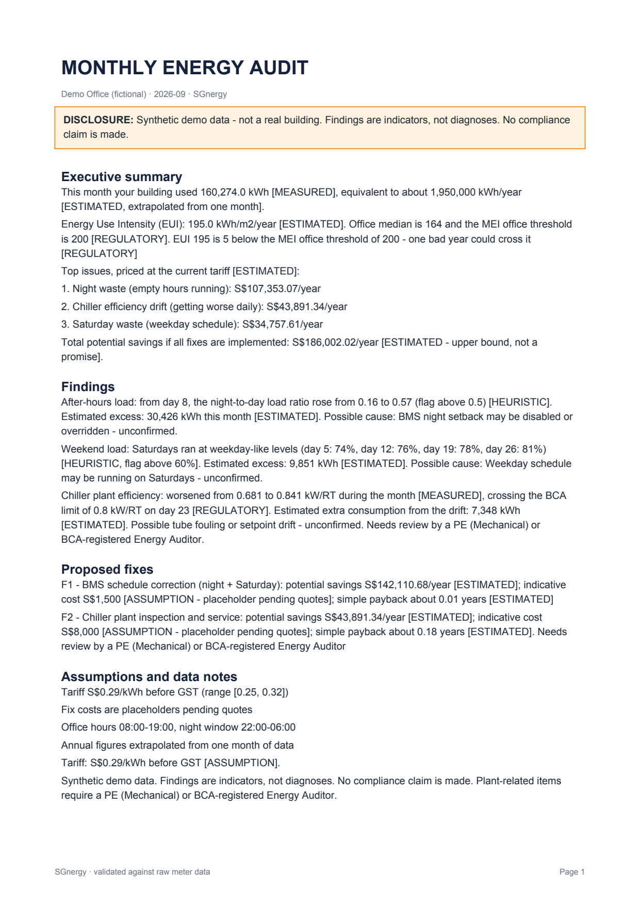
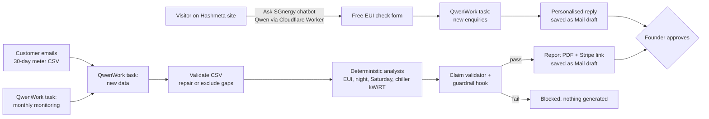

# SGnergy: a one-person energy-efficiency consultancy run on QwenWork

SGnergy finds after-hours and equipment energy waste in Singapore offices from 30 days of hourly smart-meter data. QwenWork agents handle enquiries, analysis, validated reports, payment links and monthly monitoring, and the founder approves every output before it leaves.

- **Demo video:** YOUR_YOUTUBE_LINK
- **Live site (built on Hashmeta AI):** https://sgnergy.geo.hashmeta.tech
- **Sample report (synthetic data):** [`sample-report/September-2026-SGnergy-demo.pdf`](sample-report/September-2026-SGnergy-demo.pdf)

Built for the QwenWork x Hashmeta AI OPC Hackathon 2026 (Track 1: Business Operations & Automation).



## The problem

Singapore offices often pay to light and cool empty buildings at night and on weekends, and chiller plants drift out of efficiency without anyone noticing. Under Singapore's Mandatory Energy Improvement regime, large offices with high energy use intensity (EUI) can be required to cut consumption, and owners often find out late. Most buildings already collect the hourly meter data needed to catch this early.

## How it works



Nothing is sent automatically. Every customer-facing output is a draft until the founder reviews it.

## Trust by design

- **Every figure is labelled** `MEASURED`, `ESTIMATED`, `HEURISTIC`, `BENCHMARK`, `REGULATORY`, `ASSUMPTION` or `PUBLIC-DATA` (see `config.json`).
- **Claim validator** (`pipeline/validate_report.py`) recomputes each number in the report from the meter CSV before a PDF can be built.
- **Guardrail hook** (`guardrail/guardrail_hook.py`) runs before agent tool calls and blocks report generation or email drafting when content contains forbidden promises ("guaranteed", "certified", ...), numbers that contradict the data, or untraceable figures. In the demo it rejects a report promising "guaranteed savings".
- **Email policy** (`guardrail/email_policy.json`): risk-tiered autonomy (ALLOW / APPROVE / NEVER) for outbound messages, default-deny.
- **Engineer flags:** equipment findings are marked for review by a PE (Mechanical) or BCA-registered Energy Auditor. SGnergy is not a statutory audit or certification.

## Evaluation

Two synthetic office buildings with planted faults and separate answer keys:

| Test | Result |
|---|---|
| Demo office 1 (September): scorer against answer key | 9/9 checks pass (`eval/score_results.py`) |
| Demo office 2: planted-fault check (archived run shown in the video) | 11/11 checks; both faults found, no false Saturday fault |
| Sample report PDF: claims recomputed from CSV | 25/25 (`sample-report/validation-receipt.json`) |
| Intake repair tests | pass (`eval/test_intake.py`) |
| Validator tamper tests | pass, six tamper gates (`eval/test_validator.py`) |
| Night-waste cost check | S$519 per affected weekday night (`eval/test_nightly_cost.py`) |

These come from separate synthetic runs, not one combined evaluation.

## Repository layout

```
pipeline/        intake, anomaly detection, benchmark, report content/PDF, claim validator
skills/          QwenWork SKILL.md files (lead intake, new data, validation, analysis, evaluation)
guardrail/       pre-tool-use guardrail hook and outbound email policy
ops/             automation helper (CSV validation)
eval/            answer keys, scorer, tests
clients/         two synthetic demo buildings (720 hourly rows each)
chatbot/         Ask SGnergy Cloudflare Worker + embeddable chat widget
sample-report/   polished September sample report, preview and validation receipt
docs/            export notes: provenance and known limits of this repo
```

## Run it locally

```sh
python3 -m pip install -r requirements.txt

python3 eval/test_intake.py
python3 eval/test_validator.py
python3 eval/test_nightly_cost.py
python3 pipeline/run_audit.py --client demo-office --month 2026-09
python3 eval/score_results.py
python3 clients/demo-office-2/run_demo.py --output /tmp/demo2
python3 pipeline/make_report.py --client demo-office --month 2026-09
```

`generate_data.py` regenerates the synthetic meter data with planted faults.

The chatbot needs a DashScope (Qwen) API key, stored as a Cloudflare secret (`wrangler secret put CHATBOT_DASHSCOPE_API_KEY`). No keys are committed; see `.env.example`.

## Business model

Free EUI check · S$1,500 Energy Health Check · S$500 per building per month for monitoring (prices before GST). The website also hosts a Singapore office energy map built from public building data as a lead source.

## Limitations

- All meter data is **synthetic**; Stripe runs in **test mode**. No real client data or payments.
- Savings are annualised estimates from stated assumptions, not guaranteed or realised savings, and not compliance findings.
- Some modules here are cleaned-up adaptations of the hackathon originals, and `report_pdf.py` is a simplified renderer (the polished sample PDF was made with the original). See [`docs/EXPORT_NOTES.md`](docs/EXPORT_NOTES.md) for exact provenance.
- The QwenWork automations ran locally on the founder's Mac; scheduled-task prompts are captured in the `skills/` files.

## Built with

QwenWork (agents, scheduled tasks, skills, hooks, Mail connector) · Qwen · Hashmeta AI CMS · Cloudflare Workers · Stripe (test mode) · Python (pandas, matplotlib, reportlab)

QwenWork also did the market research, built the website and produced the demo video.

---
Built by Abu Bakar Nasir.
